# Ayyaz Pharmacy Manager

**Ayyaz Pharmacy Manager** is the shop software for Ayyaz Pharmacy. It runs on the counter computer (Windows) and handles:

- **Billing at the counter (POS):** scan or search a medicine, sell by box, strip or tablet, take payment and print an 80mm receipt.
- **Stock and expiry:** every batch is tracked with its expiry date. The oldest stock is sold first, and expired stock can never be sold.
- **Medicine list:** prices, GST, generics (salts), pack sizes, barcodes and alternative brands.
- **Returns and refunds** against the original invoice.
- **Reports:** sales, profit, GST collected, invoices and stock, exportable to Excel, CSV or PDF.
- **Safety:** everything works **without internet**, all data is **encrypted**, and backups are made **automatically**.

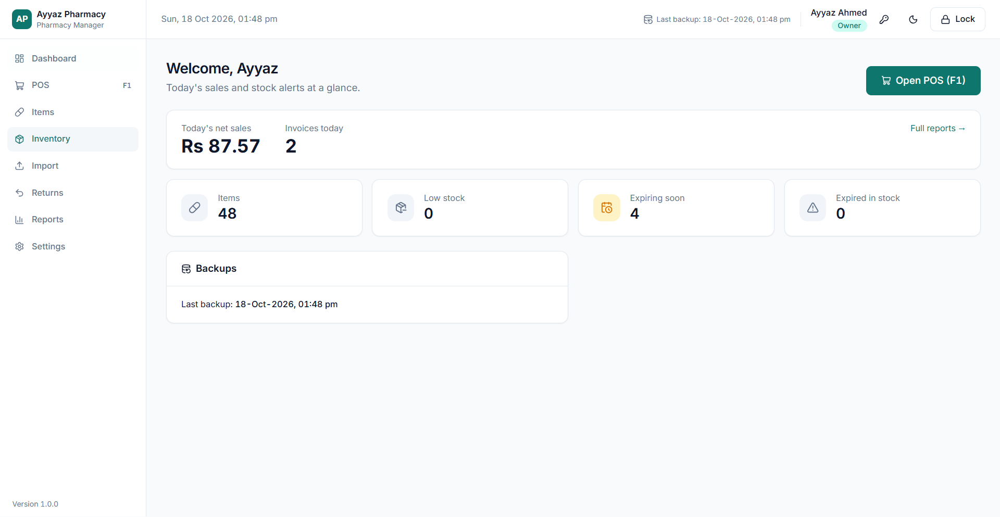

---

## Contents

1. [Installing](#1-installing)
2. [First-time setup and the recovery key](#2-first-time-setup-and-the-recovery-key)
3. [Logging in, users and roles](#3-logging-in-users-and-roles)
4. [Loading your medicine list (Import)](#4-loading-your-medicine-list-import)
5. [Selling at the counter (POS)](#5-selling-at-the-counter-pos)
6. [Returns, reprints and voids](#6-returns-reprints-and-voids)
7. [Items and stock](#7-items-and-stock)
8. [Reports](#8-reports)
9. [Settings: all options](#9-settings-all-options)
10. [Backups and moving to a new computer](#10-backups-and-moving-to-a-new-computer)
11. [How prices and GST work](#11-how-prices-and-gst-work)
12. [Questions and problems](#12-questions-and-problems)
13. [What's coming next](#13-whats-coming-next)

---

## 1. Installing

**You need:** a Windows 10 or 11 computer (4 GB RAM is enough), an 80mm thermal receipt printer, and optionally a USB barcode scanner. No internet connection is needed.

1. Run **`Ayyaz-Pharmacy-Setup-1.0.0.exe`**.
2. Windows may show _"Windows protected your PC"_, because the app isn't signed with a paid certificate yet. Click **More info → Run anyway**.
3. Choose where to install (the default is fine) and finish. A shortcut called **Ayyaz Pharmacy** is added to the desktop and the Start menu.

**Barcode scanner:** any USB scanner that "types" the barcode works. There's nothing to install; just plug it in.

**Uninstalling** keeps your pharmacy data. It's stored separately in `%APPDATA%\Ayyaz Pharmacy Manager`.

---

## 2. First-time setup and the recovery key

The first time the app opens, it asks you to **Start a new setup** (or **Restore from a backup** if you're moving from another PC; see [section 10](#10-backups-and-moving-to-a-new-computer)).

1. **Shop & owner:** enter the shop name, address, phone, drug-sale licence number and NTN/STRN (these print on receipts), then create the **Owner** account with a username and a **PIN of 4 to 8 digits**.
2. **Recovery key:** the app shows a key of 14 groups, like `CBNZ-58D3-B858-…`. **Print it or save it to a USB drive.** The _Continue_ button stays disabled until you do.
3. **Confirm:** type three groups from your saved copy to prove it was kept.

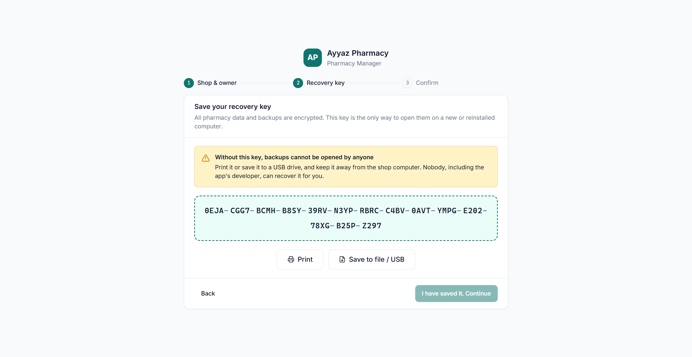

> [!IMPORTANT]
> **Keep the recovery key safe, away from the shop computer.** All pharmacy data and backups are encrypted. If Windows is reinstalled or you move to a new PC, the recovery key is the **only** way to open your data. Nobody, including the developer, can recover it for you. You can view or print it again later in **Settings → Security** (Owner PIN required).

---

## 3. Logging in, users and roles

Pick your name on the login screen and type your PIN.

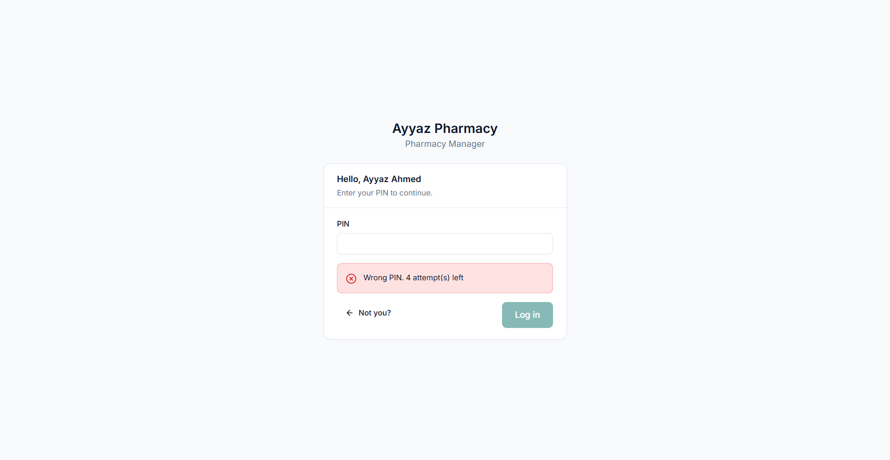

|                                                             | **Owner**   | **Staff (cashier)**                           |
| ----------------------------------------------------------- | ----------- | --------------------------------------------- |
| Sell at the POS, look up items, take returns                | ✅          | ✅                                            |
| See cost prices and profit                                  | ✅          | ❌                                            |
| Add or edit items and prices, import, adjust stock          | ✅          | ❌                                            |
| Give discounts                                              | Unlimited   | Up to the limit in Settings (default **10%**) |
| Returns outside the return window or above the refund limit | ✅          | Needs the Owner's PIN                         |
| Void an invoice                                             | Owner's PIN | Owner's PIN                                   |
| Reports, settings, users, backups                           | ✅          | ❌                                            |

**Security features:**

- The screen **locks itself** after 10 minutes without use (you can change this). Press **Ctrl+L** or click **Lock** to lock it yourself.
- After **5 wrong PINs** an account is locked for 5 minutes.
- To change your own PIN, click the 🔑 key icon at the top. The Owner can reset anyone's PIN in **Settings → Users**.
- Every login, price change, void, refund, stock adjustment and import is recorded in a permanent log that can't be edited.

---

## 4. Loading your medicine list (Import)

The quickest way to start is to load your medicine list from an **Excel (.xlsx) or CSV** file. Go to **Import** (Owner only).

**Step 1: Upload.** Click **Download Excel template** to get a ready-made sheet with the right columns and an _Instructions_ tab. Fill it in (or use your own sheet), then click **Choose file**. Files can be up to 10 MB and 50,000 rows. Formulas and macros in the file are never run.

**Step 2: Map columns.** The app guesses which column is which. Check the matches and fix any wrong ones. _brand_name_ and _sale_price_box_ are required.

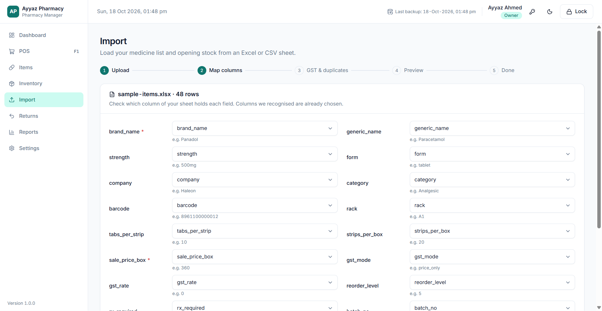

**Step 3: GST & duplicates.** Choose the GST mode and rate for rows that don't have their own (see [section 11](#11-how-prices-and-gst-work)). Then choose what happens when a row matches a medicine you already have:

| Option                          | What happens                                                           |
| ------------------------------- | ---------------------------------------------------------------------- |
| **Skip**                        | The existing item and its stock stay as they are                       |
| **Update existing** _(default)_ | The item's details and price are updated, and the row's stock is added |
| **Add as new**                  | A separate item is created                                             |

**Step 4: Preview.** Every row is checked before anything is saved: **✓ Ready**, **⚠ Warning** (e.g. expires within 90 days) or **✕ Error** (e.g. missing price, invalid expiry, expired batch). Click **Fix** to correct a row or **Skip** to leave it out. **Download rejected rows** gives you the bad rows as a spreadsheet to correct.

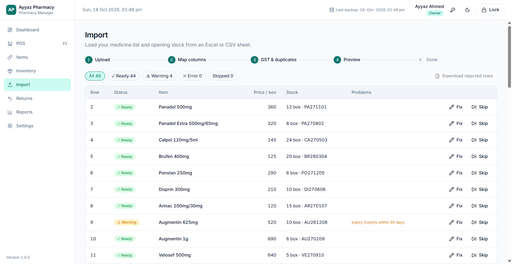

**Step 5: Import.** A backup is made automatically first. Then all valid rows are saved together: either everything is saved or nothing is.

### Template columns

| Column                                                    | Meaning                                                                                       |
| --------------------------------------------------------- | --------------------------------------------------------------------------------------------- |
| `brand_name` *                                            | Brand / trade name, e.g. Panadol                                                              |
| `generic_name`                                            | Generic / salt; separate several with `+`                                                     |
| `strength`                                                | e.g. 500mg, 120mg/5ml                                                                         |
| `form`                                                    | tablet, capsule, syrup, suspension, injection, cream, ointment, drops, inhaler, sachet, other |
| `company`                                                 | Manufacturer                                                                                  |
| `category`                                                | Free text, e.g. Antibiotic                                                                    |
| `barcode`                                                 | Box barcode, digits only                                                                      |
| `rack`                                                    | Shelf location                                                                                |
| `tabs_per_strip` / `strips_per_box`                       | Pack size (default 1). Use 1 × 1 for syrups and creams                                        |
| `sale_price_box` *                                        | Price per box in rupees                                                                       |
| `gst_mode`                                                | `add_gst` (GST added on top) or `price_only` (GST already included)                           |
| `gst_rate`                                                | e.g. 18; 0 = GST-exempt                                                                       |
| `reorder_level`                                           | Low-stock alert level, in boxes                                                               |
| `rx_required`                                             | yes / no                                                                                      |
| `batch_no`, `expiry`, `qty`, `qty_unit`, `cost_price_box` | Opening stock: expiry as MM/YYYY or DD/MM/YYYY, unit box/strip/tab, cost per box              |

\* = required. Example files for practice are in the [`samples`](samples) folder.

---

## 5. Selling at the counter (POS)

Press **F1** from anywhere (or click **Open POS**). The POS fills the whole screen and works entirely from the keyboard.

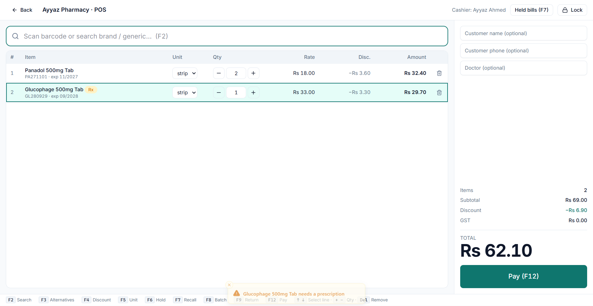

### Making a sale

1. **Scan** the barcode, or **type** a brand or generic name and press **Enter** (use ↑ ↓ to choose from the list). The search finds brands, generics and barcodes.
2. The item is added by the **strip** (or the whole pack for syrups and creams). Change the **unit** (box / strip / tablet) and **quantity** on the line, or use the shortcuts below.
3. The app picks stock from the batch that **expires first**. Expired batches are never offered. Items that need a prescription show an **Rx** badge and a warning.
4. Press **F12** to pay. Choose **Cash** (type the amount received; the change is shown in large print), **Card**, **JazzCash**, **Easypaisa** or **Bank transfer**. Non-cash payments are only recorded; the app doesn't connect to those services.
5. Press **Enter** to complete. The sale is saved with the next invoice number, and you can **View** or **Print** the receipt.

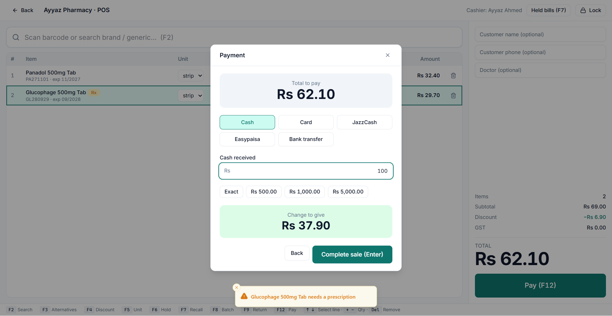

### Keyboard shortcuts

| Key        | Action                                   | Key       | Action                                        |
| ---------- | ---------------------------------------- | --------- | --------------------------------------------- |
| **F1**     | Open the POS                             | **F7**    | Recall a held bill                            |
| **F2**     | Go to the search box                     | **F8**    | Choose a specific batch for the selected line |
| **F3**     | Alternatives (same generic) for the item | **F9**    | Returns                                       |
| **F4**     | Discount on the selected line            | **F12**   | Pay                                           |
| **F5**     | Change unit (box / strip / tablet)       | **↑ ↓**   | Select a line                                 |
| **F6**     | Hold the bill                            | **+ / −** | Change quantity                               |
| **Ctrl+L** | Lock the screen                          | **Del**   | Remove the line (Undo appears)                |

### More options

- **Discounts:** **F4** gives a discount (% or Rs) on the selected line. Click **Add (F4)** next to _Discount_ in the totals panel for a discount on the **whole bill**. Discounts are taken off before GST.
- **Hold and recall:** **F6** parks the current bill (give it a name, such as the customer's), so you can serve someone else. **F7** brings it back.
- **Out of stock?** The app offers **Alternatives (F3)**: other brands with the same generic and strength, with their stock and price.
- **Customer details:** customer name, phone and doctor are optional and print on the receipt.

### The receipt (80mm)

The receipt shows the shop details, invoice number, date and cashier. For each item it shows the batch, expiry, quantity, rate, GST and amount, then the subtotal, discount, GST, **net total**, payment and change.

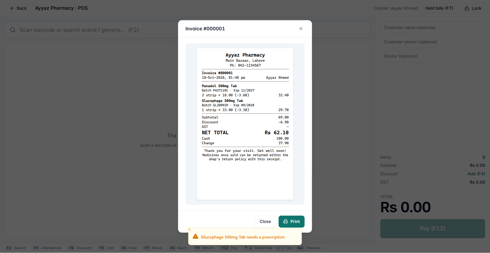

Choose your printer in **Settings → POS & receipts**. Once a printer is chosen, receipts print automatically after each sale. Until then, use **Print** on the sale-complete screen.

---

## 6. Returns, reprints and voids

### Returns

Go to **Returns** (or press **F9** in the POS). Type the **invoice number** from the receipt, or click **Return** next to one of today's invoices.

1. For each item, enter how many to return.
2. Choose whether it goes **back on the shelf** (restock) or is **written off** (damaged). Expired items are always written off.
3. Choose how the refund is paid and click **Make refund**. A refund receipt is shown and printed.

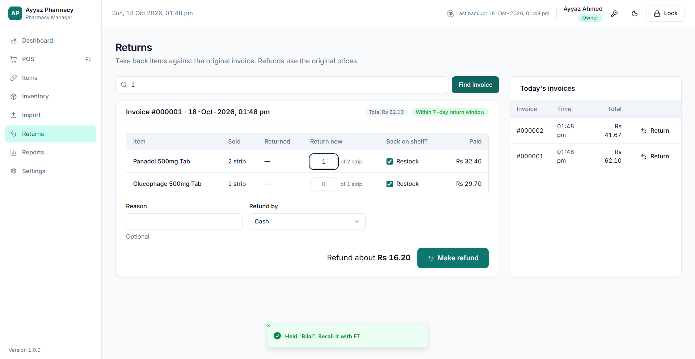

Refunds always use the **original price paid**, including any discount. Staff need the **Owner's PIN** if the sale is older than the return window (default **7 days**) or the refund is above the limit (default **Rs 2,000**).

### Reprinting and voiding

Click any invoice (in _Returns → Today's invoices_ or _Reports → Invoices_) to see it, **View** or **Reprint** the receipt (reprints say _COPY_), or **Void** it. Voiding needs a reason and the **Owner's PIN**. It puts the stock back, and the invoice stays on record marked _VOID_. Invoices can never be edited or deleted.

---

## 7. Items and stock

### Items

**Items** lists every medicine with its price, GST, pack, stock and next expiry. Search by brand, generic or barcode, or filter by _Low stock_, _Out of stock_ or _Inactive_. Click an item to see:

- **Details:** price, GST, pack, company, rack, barcodes and prescription flag. Use **Edit** to change them, or **Deactivate** to hide the item from the POS without losing its history.
- **Batches:** each batch with its expiry, quantity and price (cost too, for the Owner), plus **Add stock** and **Adjust**.
- **Alternatives:** other brands with the same generic and strength.

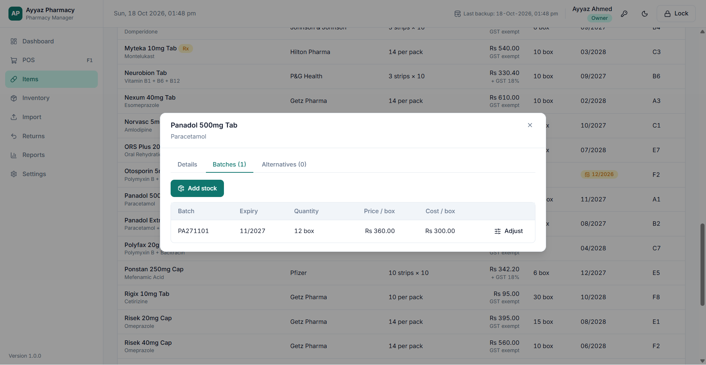

**Add item** (Owner) asks for the brand, generic, strength, form, pack size, reorder level, barcodes and the **price & GST** (see [section 11](#11-how-prices-and-gst-work)). Strip and tablet prices are worked out from the box price automatically. You can set your own strip or tablet price if you prefer.

### Stock

- **Add stock** (from an item's _Batches_ tab): batch number, expiry (MM/YYYY), quantity (box, strip or tablet), cost per box, and optionally a different sale price for that batch. If the batch already exists, the quantity is added to it.
- **Adjust** (Owner): remove or add stock with a reason: _damaged_, _lost_, _count correction_, _expired (write off)_ or _other_. Every adjustment is logged.
- **Inventory** shows all batches, oldest expiry first, with filters for **Expiring soon** (within 90 days) and **Expired**.

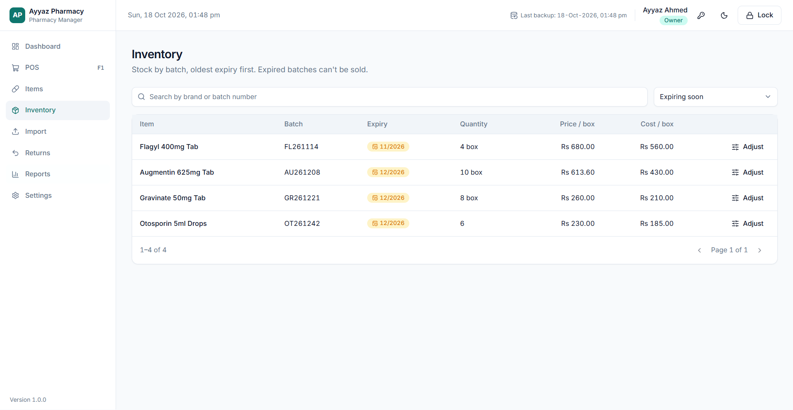

The **Dashboard** shows today's sales, the number of items, and alerts for **low stock**, **expiring soon** and **expired stock still on the shelf**.

---

## 8. Reports

**Reports** (Owner) has three tabs. Each one can be exported with **Excel**, **CSV** or **PDF**.

| Tab               | Shows                                                                                                                                                                                                 |
| ----------------- | ----------------------------------------------------------------------------------------------------------------------------------------------------------------------------------------------------- |
| **Sales summary** | For _Today, Yesterday, Last 7 days, This month, Last month_ or your own dates: net sales, GST collected, discounts, refunds, cost of goods sold, **gross profit**, sales by day and by payment method |
| **Invoices**      | Every invoice in the period (search by number). Click one to view, reprint or void it                                                                                                                 |
| **Stock**         | **Stock value** (at cost and sale price), **Expiring soon**, **Expired stock**, **Low stock (reorder list)**                                                                                          |

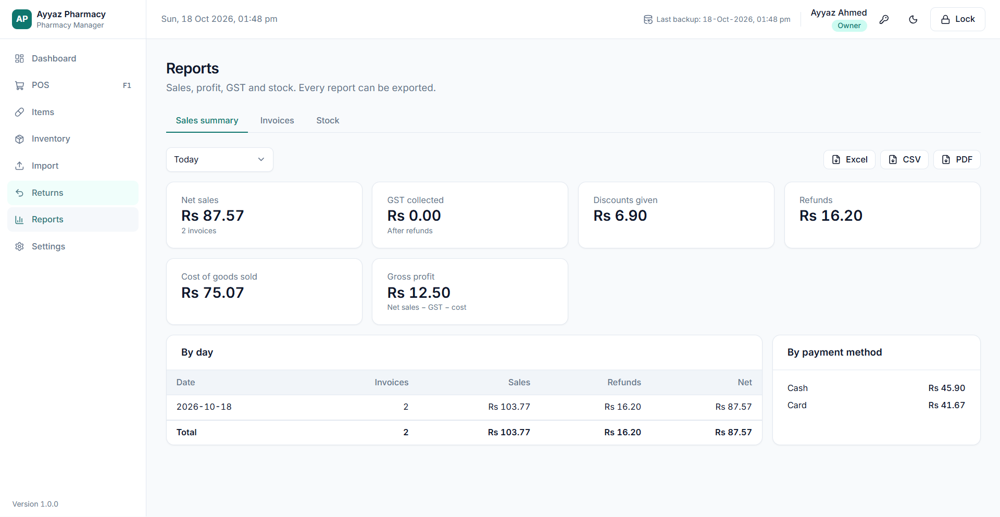

Profit = net sales − GST − cost of the medicines sold. Voided invoices are left out, and refunds are counted on the day they're made.

---

## 9. Settings: all options

**Settings** is for the Owner only.

| Tab                | Options                                                                                                                                                                      | Default                                  |
| ------------------ | ---------------------------------------------------------------------------------------------------------------------------------------------------------------------------- | ---------------------------------------- |
| **Shop**           | Name, address, phone, licence no., NTN, STRN, receipt footer                                                                                                                 | —                                        |
| **Tax & pricing**  | Default price mode (_Add GST_ / _Sale price only_) and GST rate, with a live example                                                                                         | Add GST, 18%                             |
| **POS & receipts** | Max staff discount; return window (days); refunds needing the Owner PIN above (Rs); **receipt printer**; print automatically after each sale; **Preview** and **Test print** | 10%; 7 days; Rs 2,000; ask each time; on |
| **Security**       | Auto-lock after (minutes); **Show / Print / Save the recovery key** (PIN required)                                                                                           | 10 minutes                               |
| **Backups**        | **Back up now**; **USB backup folder**; daily backup time; how many backups to keep; list of backups with **Restore**                                                        | 21:00; keep 30                           |
| **Users**          | **Add user** (Owner or Staff), edit name, role or active status, **Reset PIN**                                                                                               | —                                        |

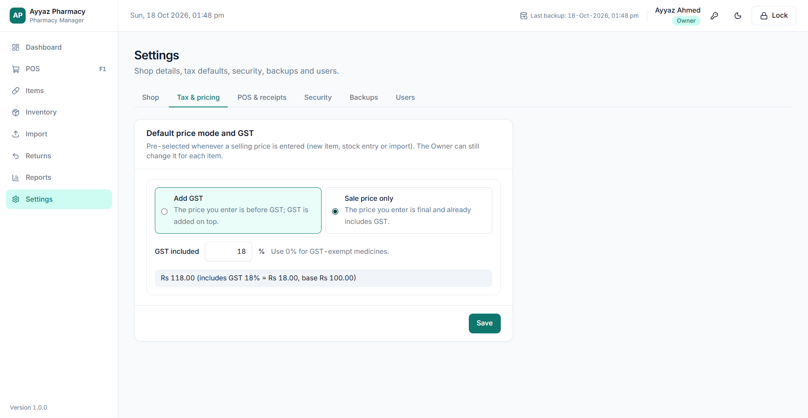

**Dark mode:** click the 🌙 moon icon at the top (each computer remembers its own choice).

---

## 10. Backups and moving to a new computer

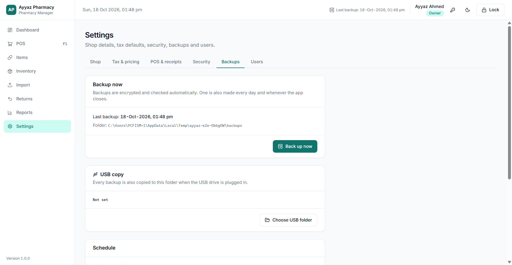

**Automatic backups** are made:

- every day at the set time (default **21:00**),
- every time the app closes,
- after the first setup, and before every import and restore.

Each backup is encrypted and checked. The last **30** are kept in `%APPDATA%\Ayyaz Pharmacy Manager\backups`.

**USB copies:** in **Settings → Backups → Choose USB folder**, pick a folder on your USB drive. Whenever that drive is plugged in, every new backup is also copied there. Keep the USB drive somewhere other than the shop computer.

**Restoring on the same PC:** in **Settings → Backups**, click **Restore** next to a backup and enter your PIN. A backup of the current data is made first, then everyone is logged out.

**Moving to a new PC (or after reinstalling Windows):**

1. Install the app on the new PC.
2. On the first screen, choose **Restore from a backup**.
3. Type the **recovery key** and choose the backup file (`.apbak`) from your USB drive.

If the data folder was copied over but Windows can't unlock it, the app asks for the **recovery key** on start-up.

---

## 11. How prices and GST work

When you enter a selling price, you choose how GST applies:

| Mode                | You enter                          | Customer pays            | Example at 18%                                                            |
| ------------------- | ---------------------------------- | ------------------------ | ------------------------------------------------------------------------- |
| **Add GST**         | Base price (before GST)            | Base + GST               | Enter Rs 100 → customer pays **Rs 118** (GST Rs 18)                       |
| **Sale price only** | Final price (GST already included) | Exactly what you entered | Enter Rs 118 → customer pays **Rs 118** (includes GST Rs 18, base Rs 100) |

- The default rate is **18%**, and you can type any rate. Use **0%** for **GST-exempt** medicines.
- Strip and tablet prices come from the box price, e.g. Rs 118 per box of 10 strips × 10 tablets = Rs 11.80 per strip, Rs 1.18 per tablet.
- **Discounts are taken off before GST.** With _Sale price only_, the customer never pays more than the printed price; any paisa rounding goes into the GST/base split.
- Each invoice keeps the price and GST that applied when it was sold, so later price changes never alter old invoices.

---

## 12. Questions and problems

**Windows says "Windows protected your PC" when installing.**
The installer isn't signed yet. Click **More info → Run anyway**.

**The receipt doesn't print automatically.**
Choose your printer in **Settings → POS & receipts** and click **Test print**. Make sure the Windows driver for the printer is installed.

**"Only 2 strips of … in stock".**
The POS sells only whole units from unexpired batches. Sell by **tablet** instead, add stock, or offer an **Alternative (F3)**.

**A staff member can't give a bigger discount or take an old return.**
That's the limit in **Settings → POS & receipts**. The Owner can type their PIN to approve returns, or raise the limits.

**Someone forgot their PIN, or is locked out.**
The Owner resets it in **Settings → Users → Reset PIN**, which also unlocks the account. If the **Owner** is locked out, wait 5 minutes and try again.

**I lost the recovery key.**
If the app still opens normally, print a new copy straight away from **Settings → Security**.

**Where is my data?**
In `%APPDATA%\Ayyaz Pharmacy Manager`: `data` (the encrypted database), `backups` and `logs`.

**Something went wrong.**
Error messages say what to do. Technical details are saved in `%APPDATA%\Ayyaz Pharmacy Manager\logs\main.log`. Send that file to whoever supports the software.

---

## 13. What's coming next

- **Phase 2:** purchases from distributors, supplier ledgers and payments, purchase returns, reorder suggestions, shop expenses, end-of-day **cash close** (Z-report), and more reports.
- **Phase 3 (optional):** FBR POS integration, customer credit (_udhaar_), Urdu receipts, a DRAP controlled-drug register, and an owner mobile view.

The full plan is in [PRD.md](PRD.md).

---

**For developers:** how to build, test and change the app is in [docs/DEVELOPMENT.md](docs/DEVELOPMENT.md).

_Ayyaz Pharmacy Manager · version 1.0.0_
